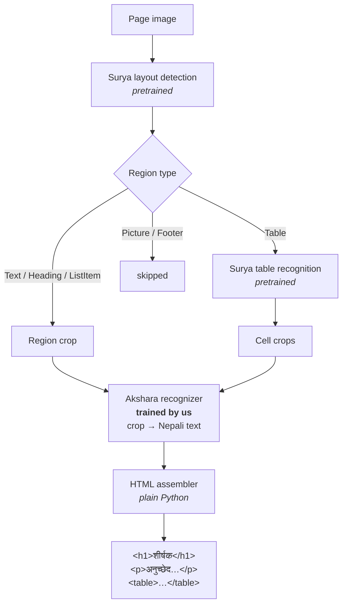
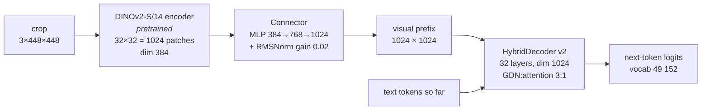
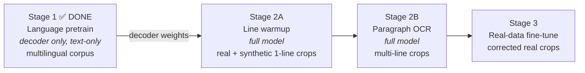

# Akshara (अक्षर) — Architecture

A small multimodal LLM built from scratch. Its first job is Devanagari + English document OCR: **page image → structured HTML**.

> **v2 update (2026-11):** the project grew from an OCR recognizer into
> a from-scratch multimodal LLM. Plan and rationale:
> **[ROADMAP_V2.md](ROADMAP_V2.md)**. What changed in this doc: own 48k
> tokenizer (§2.5), 443M decoder with QK-norm + fused attention (§2.4), Muon,
> packed-token pretraining (§3). The vision side, connector, crop pipeline
> and OCR data strategy below are unchanged.

> **Project goal is learning, not competition.** Strong open multilingual OCR
> models already exist (PaddleOCR-VL, Nemotron-OCR). Akshara is built to
> *understand how such systems are constructed* end-to-end — so we build the
> recognizer ourselves, and use the existing models/datasets as baselines and
> teachers, not as things to out-perform.

> **Status:** v1 language pretrain is **complete** (`Saurab0/akshara-pretrain`,
> ~540M tokens, dev ppl ≈ 6.7). v2 code for corpus → tokenizer → pack →
> pretrain is done and smoke-tested; the v2 pretrain run is next.

Akshara composes pretrained, language-agnostic *structure* models with a
custom-trained *recognizer*. Structure (paragraphs, headings, tables)
is geometry — ruling lines, whitespace, alignment — and pretrained models
handle it out of the box. Reading Devanagari/Latin glyphs is the part that must
be trained, and it's the only part we train.

---

## 1. System overview



| Component | Model | Trained by us? |
|---|---|---|
| Layout detection | Surya layout | No — pretrained, language-agnostic |
| Reading order | Surya (with bbox-sort fallback) | No |
| Table structure | Surya table recognition | No |
| **Text recognition** | **Akshara recognizer** | **Yes** |
| HTML assembly | ~50 lines of Python (`src/pipeline.py`) | n/a (deterministic) |

**Why not one end-to-end page→HTML model?** We tried that design first.
At 448×448 a full A4 page gives each text line ~6–8 px — Devanagari matras
and conjuncts are simply not legible. Every model that makes full-page OCR
work (Nougat 896px, GOT-OCR 1024px, Pix2Struct 80M screenshots on 64 TPUs)
lives in a data/compute regime far beyond a single free-tier A100. A *crop* resized
to 448px keeps lines at 20–50 px — fully legible — and the recognizer's job
shrinks to "read what you see."

---

## 2. The recognizer



### 2.1 Input preprocessing — aspect-preserving pad, never squash

Crops have wild aspect ratios (a line is 20:1, a table cell may be 1:2).
The image is resized so its longer side fits 448 px and pasted top-left onto
a **white** square canvas ("empty paper"). Squashing a line to a square makes
it unreadable; padding does not. Implemented in
`src/data/ocr_dataset.py::pad_to_square` — identical at train and inference.

*Upgrade path:* Pix2Struct-style variable-resolution input (scale each image
to a fixed *patch budget*, any grid shape). DINOv2's position embeddings
interpolate to any grid, so this needs no positional surgery — only batch
padding/masking. Do it when padding waste measurably hurts throughput.

### 2.2 Vision encoder — DINOv2-S/14, pretrained (~22 M params)

- `facebook/dinov2-small`, self-supervised on 142 M images, wrapped via
  `transformers.Dinov2Model` (~100-line wrapper in `src/models/vit.py`).
- 448×448 input → 14×14 patches → 32×32 = **1024 patch tokens**, dim 384.
  DINOv2's position embeddings interpolate to any grid
  (`interpolate_pos_encoding=True`), so the variable-resolution upgrade path
  survives. CLS token is dropped at output.
- **Why pretrained beats from-scratch here**: Donut/Nougat initialized from
  ImageNet Swin; Pix2Struct trained vision from scratch but with 80 M
  screenshots on 64 TPUs. On two T4s with synthetic crops, a pretrained
  encoder is the single highest-leverage choice in the system — it already
  knows edges, strokes and paper texture; training only teaches it
  Devanagari. (Surya 2's card doesn't disclose its encoder init, so it
  offers no counter-evidence.)
- DINOv2 uses the same ImageNet mean/std normalization as our datasets.
- Budget check: 1024 visual + 1024 text = 2048, well under the `4 × max_seq_len`
  (4096) the decoder's RoPE tables are sized for.

### 2.3 Connector (~0.9 M params)

Two-layer MLP (384 → 768 → 1024, GELU) followed by an **RMSNorm with gain
initialized to 0.02**. Token embeddings have per-dim std 0.02; without this
norm the visual prefix enters the residual stream ~5× hotter than text and
drowns it out early in training.

### 2.4 HybridDecoder v2 (~443 M params: 393 M body + 50 M embedding)

32 layers, width 1024, alternating **Gated DeltaNet (GDN)** and full
attention 3:1 (`attn_every=4` → every 4th layer is attention). Deep-and-thin
on purpose: below ~1B params, depth beats width at equal size (MobileLLM).
v1 was 16 × 768 with a 190 M embedding (Qwen vocab), pinned in
`configs/a100_pretrain.json`.

- **GDN layers** (24): O(T) recurrence with a per-head memory matrix
  `S ← α·S + β·(v − S·k)kᵀ` — erase-then-write associative memory.
  - Forget gate α uses `bias=+4` init → `sigmoid(4)≈0.98` — memory survives
    ~50 tokens at init instead of halving every step.
  - Recurrence runs in **fp32** even under bf16 autocast: the delta rule
    relies on near-cancellation `v − S·k`, which bf16's 8-bit mantissa
    destroys over hundreds of steps.
  - **GPU path uses FLA's chunked Triton kernel** — ~20k tok/s on an A100 in
    Stage 1, vs ~140 tok/s for the pure-Python recurrence. v2
    (`gdn_impl: native`) keeps its own projections and calls only the kernel
    (`chunk_gated_delta_rule`); the PyTorch recurrence computes the same math
    (FLA's naive reference, tested), so GPU-trained weights load and decode on
    CPU/Mac. v1 (`gdn_impl: fla_layer`) used FLA's whole `GatedDeltaNet`
    module with its own weights and needs FLA + CUDA to load.
- **Attention layers** (8): exact-recall checkpoints. GQA 16 query / 4 KV
  heads, RoPE (real cos/sin tables — complex tensors break DataParallel
  buffer replication). Tables sized `max_seq_len × 4` to cover a visual
  prefix + text; they are rebuilt from `max_seq_len` / `rope_theta` and not
  saved, so weights load into a longer-context model (2k → 16k extension).
  - **QK-norm** (v2): Q and K are RMS-normalised per head before RoPE, which
    bounds the attention logits. This is the standard fix for loss spikes
    (Qwen3, OLMo-2, Gemma-3).
  - **Fused SDPA** (v2): `F.scaled_dot_product_attention(is_causal=True,
    enable_gqa=True)` runs FlashAttention, so it never builds the T×T matrix or
    copies KV heads. The hand-written version is kept as `_reference_attention`
    and the self-check asserts the two match.
- Weight-tied embedding/LM head; depth-scaled init (`0.02/√(2·n_layers)`)
  on residual output projections.
- Loss: cross-entropy with `ignore_index=-100`. Datasets mark every target
  position after the first EOS as −100 — otherwise ~80 % of supervised
  positions are "predict EOS given EOS" and the model learns to emit empty
  pages.

### 2.5 Tokenizer — our own 48k byte-level BPE (v2)

`tokenizer/akshara-bpe`, trained by `scripts/train_tokenizer.py` on our own
corpus: NFC normalisation, a pre-tokenizer split that keeps matras, virama
and ZWJ attached to their consonants, and digits grouped 1–3. Special tokens:
`<|bos|>`=0, `<|eos|>`=1, `<|pad|>`=2, `<|image|>`, `<|im_start|>`,
`<|im_end|>`, plus 10 reserved, so stages 4–5 never resize the embedding.

Why it replaced Qwen's 248k vocab: on Devanagari, Qwen gets 1.46 chars/token
and ours gets 3.5–4.6 (48k: Nepali 4.60), and the embedding drops from 190M to 50M params. 48k beat 32k by 4–11% on every language at roughly equal compute per character. Details:
[02_tokenizer.md](02_tokenizer.md). v1 checkpoints carry
`tokenizer: Qwen/Qwen3.5-0.8B` in their config (default when absent).

---

## 3. Training curriculum

> **v2:** the full stage list is now corpus → tokenizer → pack → pretrain →
> align → instruct ([ROADMAP_V2.md](ROADMAP_V2.md)). Pretraining uses packed
> uint16 token shards (`scripts/tokenize_corpus.py` + `PackedTokenDataset`)
> and Muon on the decoder's hidden matrices (`src/optim.py`). The OCR
> curriculum below (lines → paragraphs → real) becomes the OCR task inside
> stage 5 instruction tuning.



| Stage | Script | Data | Learns | Status |
|---|---|---|---|---|
| 1 | `scripts/pretrain.py` | 965k-doc mix: 70% FineWeb-2 Devanagari (ne/hi/mr/sa) + 20% FineWeb-Edu English + 10% Wikipedia | grammar, script, vocabulary | ✅ done (ppl ≈ 6.7) |
| 2A | `scripts/train_ocr.py` | real lines (ocr-mlt-50m, Mozhi-LR) + small synthetic | glyph recognition (conjuncts, matras) | next |
| 2B | `scripts/train_ocr.py` | multi-line crops | multi-line reading, layout robustness | |
| 3 | `scripts/train_ocr.py` | real corrected crops | domain adaptation | |

**Stage 1 result:** trained on a Lightning.ai A100 with the FLA kernel to step
5400 (~540M tokens). Language eval: fluent Nepali (formal register + dates +
code-switching all correct), functional-but-repetitive English, and both
perplexity minimal-pair tests pass. Checkpoint: `Saurab0/akshara-pretrain`.

**Why lines before paragraphs (2A → 2B):** Pix2Struct
([arXiv:2210.03347](https://arxiv.org/abs/2210.03347)) showed that a
"warmup" stage of simply *learning to read* rendered text snippets makes
pretraining stabler, faster-converging, and better at fine-tuning time
(−11.6 ANLS on DocVQA without it). Our 2A is exactly that warmup, with
Nepali fonts.

**The two phases are one generator knob.** Line crops render on the same
448 canvas as paragraphs (random vertical position = free augmentation);
2B just raises `max_lines` from 1 to ~12. Same model, same input geometry,
no positional surgery between phases.

**What we deliberately do NOT copy from Pix2Struct:** its 50 % text masking.
Predicting invisible text is the point for visual language understanding —
for faithful OCR it explicitly trains hallucination. The recognizer is only
ever supervised on visible text.

**Stage 2 warm-start:** decoder loads Stage-1 weights; vision encoder +
connector start random. The encoder is frozen for the first ~1 000 steps so
random vision gradients don't wreck the pretrained language weights.

---

## 4. Data formats

**Stage 1 (text):** JSONL, one object per line
```json
{"text": "नेपाली पाठ यहाँ छ"}
```

**Stages 2–3 (crops):** JSONL, one object per line
```json
{"image": "crops/000123.png", "text": "यो एक हरफ हो"}
```
- `image` paths absolute or relative to the JSONL file
- `image_path` / `html` accepted as legacy aliases
- targets are **plain text** — no HTML tags. Structure comes from the
  layout model at inference, never from the recognizer.

Sequence construction (`CropOCRDataset`):
```
input   = [BOS] t₁ … tₙ [EOS] [EOS] … [EOS]   ← pad with EOS (embeddable)
target  =  t₁ … tₙ [EOS] [-100] … [-100]       ← pad with -100 (loss-masked)
```

### Data strategy — real-first, synthetic as a small supplement (surveyed 2026-07)

Real labeled data now exists in enough quantity that it carries the bulk of
Stage 2; synthetic is a supplement (paragraph layouts, curriculum knob, a
small run to *understand* the technique) rather than the foundation. This also
sidesteps the font/libraqm grunt for most of training.

| Dataset | Content | Role |
|---|---|---|
| [interfaze-ai/ocr-mlt-50m](https://huggingface.co/datasets/interfaze-ai/ocr-mlt-50m) | 50 M image-text pairs, 50 langs incl. **ne/hi + en**, printed, Apache 2.0, on HF | filter `lang ∈ {ne,hi,en}` → **primary bulk Stage 2A** |
| [Mozhi-LR (CVIT/IIIT)](https://cvit.iiit.ac.in/images/ConferencePapers/2024/Printed-OCR-for-Extremely-Low-resource-Indic-Languages.pdf) | **real printed Nepali** word images + transcriptions (real + synthetic variants) | best real Nepali — Stage 2A/3 |
| [oscar-corpus/mOSCAR](https://huggingface.co/datasets/oscar-corpus/mOSCAR) | interleaved image-text web corpus (NOT OCR-aligned), Devanagari incl. | **image source** to pseudo-label with a teacher → real (crop,text) pairs |
| [heiDATA printed Devanagari](https://heidata.uni-heidelberg.de/dataset.xhtml?persistentId=doi:10.11588/data/EGOKEI) | 5 139 real printed line images + ALTO XML | held-out **eval set** — never train on it |

**Existing models as baseline + teacher (not replacement):**
[PaddleOCR-VL](https://huggingface.co/docs/transformers/model_doc/paddleocr_vl)
(109 langs, Devanagari+Latin) and Nemotron-OCR. Run one on our eval crops for a
**reference CER** (how far off are we?), and optionally as a **teacher** to
pseudo-label mOSCAR images into real training pairs. Its Nepali quality gates
whether the mOSCAR pseudo-labeling path is worth taking.

`src/data/synth_data.py` hard-fails if PIL lacks **libraqm** — without it
Devanagari matras/conjuncts render in wrong positions and every label would be
silently corrupt. Mixed-script crops also need fonts covering both Devanagari
and Latin (open item). Because real data now carries the bulk, this only has to
work at small scale.

---

## 5. Repository map

```
akshara/
├── config/config.py          # dataclass configs (defaults = v1; v2 set in configs/base.json)
├── configs/*.json             # per-stage overrides
├── scripts/
│   ├── pretrain.py            # decoder LM pretraining, HF-backup on save
│   ├── train_tokenizer.py     # own byte-level BPE (v2)
│   ├── tokenize_corpus.py     # JSONL → packed uint16 .bin (v2)
│   ├── train_ocr.py           # Stages 2A/2B/3 (crop OCR)
│   ├── generate.py            # single-image inference
│   ├── prepare_data.py        # streaming char-budgeted corpus (FineWeb-2/Edu, FineMath, Wiki)
│   ├── hf_uploader.py         # detached checkpoint backup to HF Hub
│   ├── lm_sample.py           # quick language sanity check
│   └── lm_eval.py             # thorough language eval (gen + perplexity pairs)
├── src/
│   ├── models/
│   │   ├── vit.py             # DINOv2-S/14 wrapper (pretrained)
│   │   ├── connector.py       # MLP bridge + scale-matching RMSNorm
│   │   ├── hybrid_decoder.py  # 3:1 GDN/attention decoder
│   │   ├── gdn_block.py       # Gated DeltaNet (fp32 recurrence)
│   │   ├── attention.py       # GQA + RoPE + QK-norm, fused SDPA
│   │   ├── rope.py            # real cos/sin tables
│   │   └── vlm.py             # Akshara = encoder+connector+decoder
│   ├── data/
│   │   ├── text_dataset.py    # PackedTokenDataset (.bin) + JSONL
│   │   ├── ocr_dataset.py     # CropOCRDataset, pad_to_square
│   │   └── synth_data.py      # synthetic crop generator (supplement)
│   ├── optim.py               # Muon (hidden matrices) + AdamW (rest)
│   └── pipeline.py            # Surya layout → recognizer → HTML
└── kaggle_run.py              # legacy Kaggle entry point (unused; on Lightning now)
```

---

## 6. Hardware, infra & known limits

- **Where it runs:** Stage 1 trained on a **Lightning.ai A100** (bf16, FLA
  kernel, ~20k tok/s, batch 16×12). Single-GPU; the `nn.DataParallel` +
  `loss.mean()` path is retained for multi-GPU but unused. (Kaggle T4 was the
  original target; `kaggle_run.py` is legacy.)
- **Ephemeral-machine playbook** (learned the hard way — a 9h run was lost
  once): the training box's disk and conda env do **not** survive a session
  end. So:
  - **Back up to HF every checkpoint** (`hf_repo` in the run config — v2:
    `Saurab0/akshara-pretrain-v2`; it defaults to off so smoke runs never upload,
    write-scoped token, `huggingface-cli login`). The HF namespace is
    **case-sensitive** (`Saurab0` ≠ `saurab0`).
  - **Install `flash-linear-attention` on each GPU machine** for speed (v1
    checkpoints also need it to load; v2 weights load anywhere).
  - **Download the packed corpus each session** from the private
    `Saurab0/akshara-corpus-v6` dataset (it's not persisted on the box).
  - On a **free-tier allowance**, measure tok/s early and **set `train_steps`
    so the WSD decay lands inside the budget**; the pre-decay checkpoint lets a
    finished run be extended later.
- **Cached inference:** `generate()` keeps a KV cache for the attention layers
  and the GDN memory state, so each new token is one step; the image is
  encoded once. `src/speculative.py` adds speculative decoding (draft model
  with the same tokenizer; greedy output identical to the target's).
- **Surya API drift:** `src/pipeline.py` imports surya lazily and pins
  loosely; check `surya-ocr` version if layout calls break.
